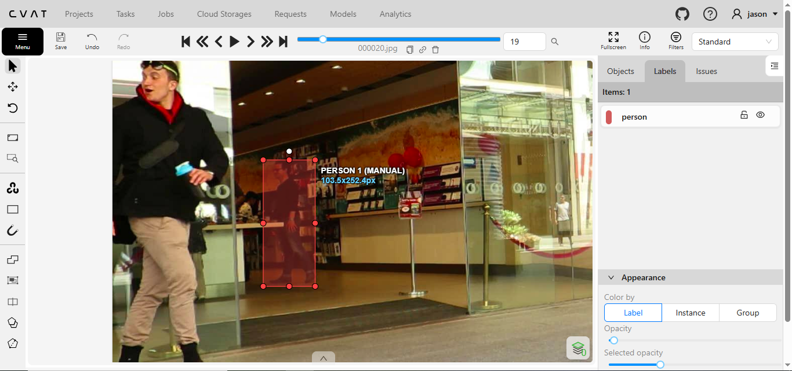
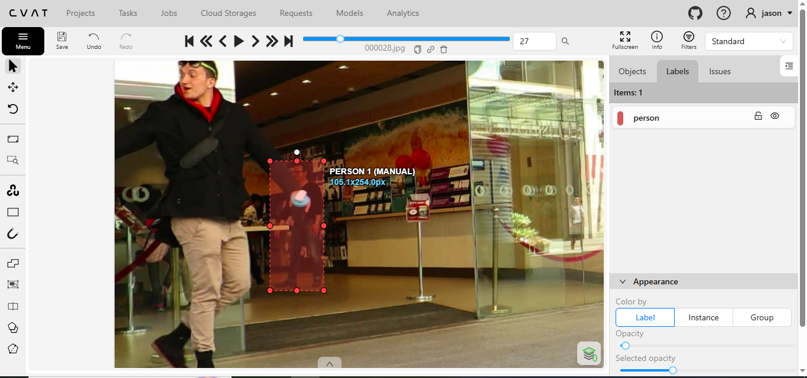
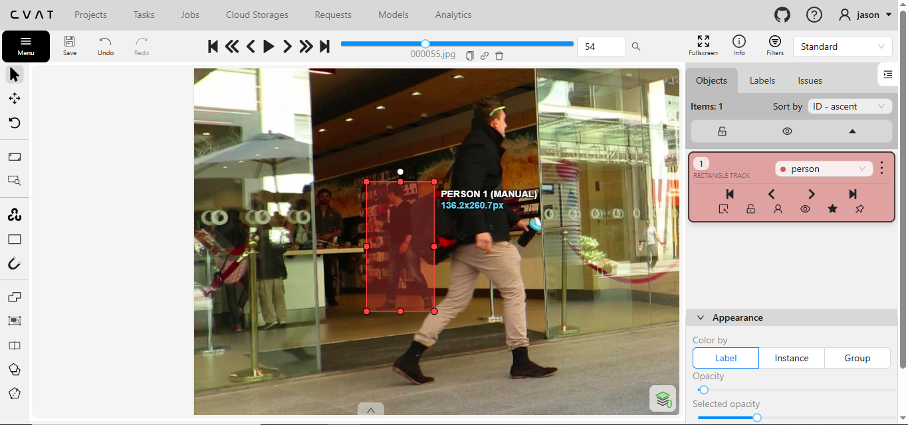

# Báo cáo cá nhân — VoDuyThanh-2A202603211

Đoạn video: MOT17-09, 150 frame (frame 1–150), nguồn MOTChallenge, giấy phép CC BY-NC-SA 3.0.

Số frame trong báo cáo ghi theo CVAT (0–149). Trong `gt.txt`, `frame_id` = frame CVAT + 1.

## 0. Thông tin học viên

- Họ tên: Võ Duy Thành
- MSSV: 2A202603211
- Mã đề (A/B/C): A
- Email: 11thanh2233@gmail.com
- Link repository: https://github.com/11thanh2233/K5-L2-DAY05-VoDuyThanh-2A202603211-MOTTracking.git
- Giờ bắt đầu: 16h30
- Giờ kết thúc: 19h30
## 1. Xem trước đoạn video (CP0)


| Mã  | Frame xuất hiện | Frame cuối thấy được | Rẽ / dừng / đổi tốc độ ở frame | Bị che ở frame                                                              | Ghi chú                                                             |
| --- | --------------- | -------------------- | ------------------------------ | --------------------------------------------------------------------------- | ------------------------------------------------------------------- |
| P1  | 0               | 149                  | 70                             | Che một phần 27–38 và 45–53; khuất hẳn 39–44                                | Người dùng cho bài xử lý che khuất (CP2)                            |
| P2  | 42              | 149                  | 75                             | Che một phần 42–60                                                          | Vào khung từ frame 42                                               |
| P3  | 0               | 149                  | Không có                       | Không gán cờ che                                                            | Box lớn dần về cuối đoạn (cao 347 px ở frame 0, 843 px ở frame 149) |
| P4  | 0               | 149                  | Không có                       | Che một phần 0–20                                                           | Box chạm mép phải khung hình (x = 1920) từ frame 0 đến frame 69     |
| P5  | 0               | 146                  | Không có                       | Che một phần 106–109, 137–138, 144–146; khuất hẳn 110–136; `outside` từ 147 | Box không đổi vị trí từ frame 39 đến frame 109                      |

## 2. Keyframe và thời gian (CP1, CP4)

Số keyframe lấy từ kết quả `src/check_submission.py`.

| Mã       | Số keyframe | Keyframe ở frame                                                                                                                                                                                                                                                                                                                                                                     | Số frame có mặt | Keyframe / 100 frame | Thời gian (phút) | Chỗ khó  |
| -------- | ----------- | ------------------------------------------------------------------------------------------------------------------------------------------------------------------------------------------------------------------------------------------------------------------------------------------------------------------------------------------------------------------------------------ | --------------- | -------------------- | ---------------- | -------- |
| P1       | 86          | 0, 9, 11, 15, 16, 18, 23, 27, 28, 29, 30, 31, 33, 34, 38, 45, 46, 47, 49, 53, 54, 55, 56, 57, 61, 62, 63, 64, 65, 66, 67, 68, 69, 72, 73, 75, 76, 78, 79, 80, 81, 82, 85, 86, 87, 89, 92, 93, 94, 95, 96, 97, 98, 99, 100, 101, 102, 103, 104, 105, 106, 107, 108, 109, 110, 111, 112, 113, 114, 115, 116, 118, 121, 122, 126, 127, 128, 129, 139, 141, 143, 144, 145, 146, 148, 149 | 144             | 59.7                 | 20               | Không có |
| P2       | 26          | 42, 45, 46, 48, 50, 59, 60, 61, 69, 73, 74, 75, 76, 78, 79, 89, 93, 99, 102, 105, 109, 119, 129, 139, 146, 149                                                                                                                                                                                                                                                                       | 108             | 24.1                 | 10               | Không có |
| P3       | 39          | 0, 2, 8, 12, 14, 16, 17, 19, 20, 21, 29, 30, 31, 39, 49, 57, 59, 69, 79, 81, 82, 83, 84, 87, 89, 93, 99, 109, 119, 122, 124, 125, 129, 133, 135, 139, 144, 146, 149                                                                                                                                                                                                                  | 150             | 26.0                 | 10               | Không có |
| P4       | 22          | 0, 9, 13, 16, 17, 18, 19, 21, 29, 31, 39, 49, 59, 69, 79, 89, 99, 109, 119, 129, 139, 149                                                                                                                                                                                                                                                                                            | 150             | 14.7                 | 10               | Không có |
| P5       | 14          | 0, 9, 14, 17, 20, 31, 39, 79, 106, 109, 137, 139, 140, 144                                                                                                                                                                                                                                                                                                                           | 120             | 11.7                 | 10               | Không có |
| **Tổng** | 187         |                                                                                                                                                                                                                                                                                                                                                                                      | 672             | 27.8                 | 60               |          |

Keyframe / 100 frame của cả bài = tổng keyframe ÷ tổng số frame có mặt × 100 = 187 ÷ 672 × 100 = 27.8

Bạn đặt keyframe nhiều nhất ở người nào? Vì sao (người đó rẽ, dừng, lại gần camera hay bị che)?

Nhiều nhất ở P1: 86 keyframe trên 144 frame có mặt (59.7 keyframe / 100 frame), vượt ngưỡng 50 của lớp nên script báo `[CẢNH BÁO]`. P1 là người bị che: 17 keyframe nằm trong đoạn 27–57 quanh chỗ che (bật `occluded` ở 27, `outside` ở 39, hiện lại ở 45, tắt `occluded` ở 54). Phần còn lại dồn vào đoạn 61–116, trong đó frame 92–116 có keyframe ở mọi frame (25 keyframe trên 25 frame); ở đoạn này toạ độ mép trái box chỉ thay đổi dưới 8 px giữa hai keyframe liền nhau (dao động trong khoảng x = 457.8–472.6), nên đây là chỗ đặt keyframe dày hơn mức cần thiết.

## 3. Đoạn bị che (CP2)

Người bị che: `P1`

| Mốc | Frame |
|---|---:|
| Bắt đầu bị che một phần (bật `occluded`) | 27 |
| Mất hẳn (bật `outside`) | 39 |
| Hiện lại (tắt `outside`) | 45 |
| Thấy rõ trở lại (tắt `occluded`) | 54 |

- Thời gian khuất hẳn: 6 frame (39–44) = 0,2 giây (6 ÷ 30 fps).
- Quyết định: giữ cùng ID.
- Lý do (trả lời 3 câu: khuất bao lâu so với 60 frame, ngoại hình có khớp, chỗ hiện lại có đúng hướng và tốc độ):

1. Khuất hẳn 6 frame < 60 frame.
2. Ngoại hình: Khớp, vẫn là cùng 1 người.
3. Chỗ hiện lại đúng hướng đi cũ: trước khi che, box dịch dần sang phải (mép trái từ x = 243 ở frame 0 đến x = 303 ở frame 23–38); ở frame hiện lại 45, mép trái ở x = 332, tức tiếp tục dịch sang phải khoảng 29 px so với frame 38, không nhảy vị trí.

Ảnh chụp màn hình:





## 4. Tự review ID (CP3)

Lượt 1 theo người (đi ngược từ frame 149 về 0 trên CVAT), lượt 2 theo cảnh (nhảy 10 frame). Ít nhất 3 dòng; không có lỗi thì ghi một dòng "đã kiểm hai lượt, không lỗi".

Loại lỗi dùng đúng một trong 7 mã: `id_switch`, `fragmentation`, `lost`, `merge`, `false_track`, `drift`, `flag`.

|   Frame | Mã người | Loại lỗi  | Mô tả một câu                                                                                                                                         | Phát hiện ở lượt | Đã sửa?       |
| ------: | -------- | --------- | ----------------------------------------------------------------------------------------------------------------------------------------------------- | ---------------- | ------------- |
| 135–136 | P5       | `lost`    | P5 đã hiện lại giữa P3 và P4 (thấy một phần ở 135, thấy rõ mặt và thân ở 136) nhưng `outside` vẫn bật đến hết frame 136, box chỉ có lại từ frame 137. | 1                | Chưa sửa      |
|   39–54 | P1       | không lỗi | Trước và sau đoạn khuất hẳn vẫn là một track, khi P1 thấy rõ lại ở frame 54 box nằm đúng trên P1, không có `id_switch` hay `fragmentation`.           | 1                | Không cần sửa |
|  40–149 | P3, P4   | không lỗi | Hai người đi sát nhau, box chồng mép từ khoảng frame 40 nhưng mỗi ID vẫn bám đúng một người ở mọi frame đã xem, không có `id_switch` hay `merge`.     | 2                | Không cần sửa |

Tổng hợp số lỗi theo loại:

| `id_switch` | `fragmentation` | `lost` | `merge` | `false_track` | `drift` | `flag` |
|---:|---:|---:|---:|---:|---:|---:|
| 0 | 0 | 1 | 0 | 0 | 0 | 0 |

Lỗi nào chỉ lượt 2 (theo cảnh) mới thấy, lượt 1 (theo người) không thấy? Vì sao?

Không có lỗi nào chỉ lượt 2 mới thấy.

## 5. File xuất và kết quả tự kiểm (CP4)

| Kiểm tra                                                  | Kết quả                                                                                         |
| --------------------------------------------------------- | ----------------------------------------------------------------------------------------------- |
| Tên file MOT 1.1                                          | `src/exports/VoDuyThanh_mot.zip`                                                                |
| Tên file CVAT for video 1.1                               | `src/exports/VoDuyThanh_cvat_video.zip`                                                         |
| Số track ID khác nhau trong `gt/gt.txt` (phải là 5)       | 5                                                                                               |
| Frame `outside` không có dòng trong `gt.txt` (đúng / sai) | Đúng: ID 1 không có dòng ở frame CVAT 39–44, ID 4 không có dòng ở frame CVAT 110–136 và 147–149 |
| Job đã completed trên CVAT máy cá nhân                    | Có                                                                                              |

Dán phần tóm tắt in ra từ `src/check_submission.py`:

```text
Số frame in theo CVAT (bắt đầu từ 0). Trong gt.txt, frame_id = frame CVAT + 1.

=== File MOT 1.1: VoDuyThanh_mot.zip ===
  Số track ID: 5   |   Tổng số box: 672
  [OK]        Đúng 5 track ID.

  Track | Frame có mặt | Số frame | Đoạn vắng (outside)
      1 |   0–149      |      144 | 39–44
      2 |   0–149      |      150 | -
      3 |   0–149      |      150 | -
      4 |   0–146      |      120 | 110–136
      5 |  42–149      |      108 | -


=== File CVAT for video 1.1: VoDuyThanh_cvat_video.zip ===

  Track | Nhãn   | Frame thấy | Keyframe | KF/100 frame | Frame occluded | Lần bật outside
      0 | person |        144 |       86 |         59.7 |             21 |               1
              Track 0: keyframe ở frame [0, 9, 11, 15, 16, 18, 23, 27, 28, 29, 30, 31, 33, 34, 38, 45, 46, 47, 49, 53, 54, 55, 56, 57, 61, 62, 63, 64, 65, 66, 67, 68, 69, 72, 73, 75, 76, 78, 79, 80, 81, 82, 85, 86, 87, 89, 92, 93, 94, 95, 96, 97, 98, 99, 100, 101, 102, 103, 104, 105, 106, 107, 108, 109, 110, 111, 112, 113, 114, 115, 116, 118, 121, 122, 126, 127, 128, 129, 139, 141, 143, 144, 145, 146, 148, 149]
  [CẢNH BÁO]  Track 0: 60 keyframe / 100 frame > 50. Quá dày, dồn keyframe vào chỗ rẽ / dừng / bị che.
      1 | person |        108 |       26 |         24.1 |             19 |               0
              Track 1: keyframe ở frame [42, 45, 46, 48, 50, 59, 60, 61, 69, 73, 74, 75, 76, 78, 79, 89, 93, 99, 102, 105, 109, 119, 129, 139, 146, 149]
      2 | person |        150 |       39 |         26.0 |              0 |               0
              Track 2: keyframe ở frame [0, 2, 8, 12, 14, 16, 17, 19, 20, 21, 29, 30, 31, 39, 49, 57, 59, 69, 79, 81, 82, 83, 84, 87, 89, 93, 99, 109, 119, 122, 124, 125, 129, 133, 135, 139, 144, 146, 149]
      3 | person |        150 |       22 |         14.7 |             21 |               0
              Track 3: keyframe ở frame [0, 9, 13, 16, 17, 18, 19, 21, 29, 31, 39, 49, 59, 69, 79, 89, 99, 109, 119, 129, 139, 149]
      4 | person |        120 |       14 |         11.7 |              9 |               2
              Track 4: keyframe ở frame [0, 9, 14, 17, 20, 31, 39, 79, 106, 109, 137, 139, 140, 144]

  Tổng: 187 keyframe / 672 frame có mặt = 27.8 keyframe / 100 frame
  [OK]        Đọc được 5 track từ annotations.xml.

=== Tóm tắt ===
  Lỗi: 0   |   Cảnh báo: 1
  Không có lỗi định dạng. Mở CVAT xem lại từng [CẢNH BÁO]; cảnh báo đúng ý bạn thì ghi lý do vào báo cáo.
```

## 6. Ba câu kết

1. Nếu được gán lại, bạn sẽ đặt keyframe khác ở đâu? Vì sao?

   Hai chỗ. Thứ nhất, bỏ bớt keyframe của P1 ở đoạn 92–116: đoạn này có keyframe ở cả 25 frame trong khi mép box chỉ lệch dưới 8 px giữa hai frame liền nhau, tức nội suy tuyến tính đã đủ đúng; chỉ cần giữ keyframe cách nhau 5–10 frame là P1 xuống dưới ngưỡng 50 keyframe / 100 frame. Thứ hai, dời keyframe "hiện lại" của P5 từ frame 137 về frame 135–136, vì ở đó P5 đã thấy được giữa P3 và P4. Keyframe nên dồn vào quanh đoạn che (ngay trước khi mất và ngay khi hiện lại), không phải đoạn người đi gần như đều.

2. Có chỗ nào bạn không chắc "cùng ID hay ID mới"? Bạn đã quyết định và ghi chú thế nào?

   Chỗ phải cân nhắc nhất là P5. Vì P5 khuất hẳn sau P3 và P4 từ frame 110 đến 136, tức 27 frame = 0,9 giây, dài hơn nhiều nhưng vẫn dưới ngưỡng 60 frame. Khi hiện lại, P5 vẫn ở đúng chỗ cũ (mép trái box x = 1308 trước khi che, x = 1321 khi hiện lại, chiều cao box gần như không đổi, 128 px và 127 px) và ngoại hình khớp (váy trắng xanh, giày đỏ), nên giữ cùng track, ID 4 trong `gt.txt`. Cả hai lần che đều xử lý bằng cờ `outside` trên cùng một track, không tạo track mới.

3. Một lỗi ID trong job của bạn (nếu không còn sót, chọn lỗi đã sửa) có thể làm xe tự lái dự đoán sai chuyển động của người đó như thế nào? Lỗi đó ảnh hưởng MOTA hay IDF1 nhiều hơn?

   Lỗi còn sót là `lost` của P5 ở frame 135–136: nhãn nói em bé chưa có mặt trong khi em đã hiện ra giữa hai người lớn. Tracker học và được chấm theo nhãn này sẽ bị coi là sai nếu phát hiện em bé sớm, tức bị kéo về phía xác nhận người đi bộ muộn hơn sau khi bị che; với xe tự lái, một em bé bước ra từ sau người lớn là tình huống cần phát hiện sớm nhất, nên trễ dù chỉ vài frame cũng là trễ thời gian phanh. Lỗi này ảnh hưởng MOTA nhiều hơn: mỗi frame thiếu box là một FN, cộng thẳng vào tử số của MOTA. IDF1 chỉ giảm nhẹ vì mất 2 box ghép đúng, còn ID của P5 trước và sau đoạn che vẫn là một nên không có IDSW. Nếu ở chỗ này tạo track mới thay vì tắt `outside`, thì ngược lại IDF1 mới là chỉ số giảm mạnh.

## Bonus (nếu làm)

Không làm bonus.

## 7. Tài liệu tham khảo và công cụ AI đã dùng

Không có
